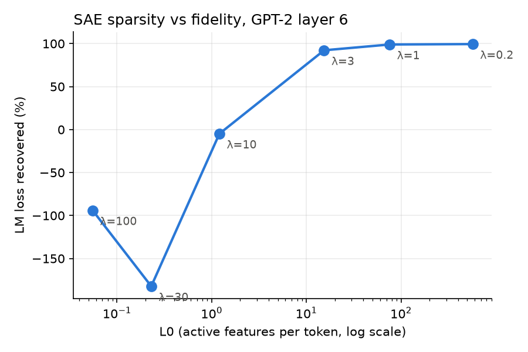

# Project 5 — Sparse Autoencoders (Dictionary Learning)

**Question:** *can we decompose activations into interpretable features?*

## Idea

Individual neurons are often **polysemantic** — they fire in many unrelated
contexts — plausibly because models represent more features than they have
dimensions, storing them in **superposition**
([Elhage et al., 2022](https://transformer-circuits.pub/2022/toy_model/index.html)).
A **sparse autoencoder (SAE)** tries to undo the compression: it learns an
overcomplete dictionary of directions such that each activation vector is a
sparse non-negative combination of them. Individual dictionary elements
("features") tend to be far more interpretable than neurons
([Cunningham et al., 2023](https://arxiv.org/abs/2309.08600);
[Bricken et al., 2023 — *Towards Monosemanticity*](https://transformer-circuits.pub/2023/monosemantic-features/index.html)),
and the approach scales to frontier models
([Templeton et al., 2024 — *Scaling Monosemanticity*](https://transformer-circuits.pub/2024/scaling-monosemanticity/index.html)).

## Architecture (the standard 2023 recipe)

```
f     = ReLU(W_enc (x − b_dec) + b_enc)     # sparse feature activations
x_hat = W_dec f + b_dec                     # reconstruction
loss  = ‖x − x_hat‖² + λ·Σf                 # fidelity + L1 sparsity
```

Decoder rows are renormalized to unit norm every step — otherwise the model
cheats the L1 penalty by shrinking `f` and growing `W_dec`.

## Run it

```bash
python train_sae.py                  # ~1-2 min on CPU
python train_sae.py --l1 3          # sparser, worse reconstruction
python sweep_l1.py                  # sparsity/fidelity trade-off, ~6 min
```

Downloads tiny-shakespeare (~1 MB), collects ~60k layer-6 residual-stream
vectors from GPT-2 small, trains a 768→3072 SAE, measures how much LM loss
survives splicing the reconstruction back into the model, then prints
top-activating contexts for a sample of features.

**Position 0 is excluded.** GPT-2's first token is an "attention sink" whose
residual norm is ~40× any other position's: kept in, those <1% of tokens carry
>90% of the squared norm and dominate the scale normalization and the MSE.

## What you should see

```
step     0  mse 2267.390  L0 (active feats)  1544.5
step  1999  mse   52.595  L0 (active feats)    75.7

L0 75.7   variance explained 86.7%
LM loss: clean 4.918  with SAE 4.945  mean-ablated 7.564  -> 99.0% of loss recovered
```

**Loss recovered** is the metric that matters: it asks whether the model can
still *use* the reconstruction. 0% = as bad as replacing layer 6 with its mean
activation, 100% = as good as the original.

Per-feature summaries — at this sparsity most sampled features have an
obvious theme:

```
feature 326 (fires on 0.4% of tokens):
    ... bear against the great Auf[[id]]
    ... hearing. Stand, Auf[[id]]

feature 2827 (fires on 3.4% of tokens):
    ... years upon thee; and thou[[ art]]
    ... to them,\nThou[[ art]]

feature 23 (fires on 5.8% of tokens):
    ...\nBRUTUS:\n[[Sir]]
    ...MENENIUS:\n[[Sir]]
```

Others are still mixed (e.g. a feature on `restrain`, `blind`, `ruin`,
`strong`). Feature quality depends heavily on data volume, dictionary size,
and the sparsity/fidelity trade-off.

## The L1 sweep



| λ (`--l1`) | L0 | variance explained | dead feats | feats firing on >10% | loss recovered |
|---:|---:|---:|---:|---:|---:|
| 0.2 | 571 | 94.9% | 30 | 2116 | 99.5% |
| **1** | **76** | **86.7%** | **75** | **80** | **99.0%** |
| 3 | 15 | 74.6% | 578 | 6 | 92.2% |
| 10 | 1.2 | −13% | 3061 | 1 | −4.8% |
| 30 | 0.2 | −61% | 2157 | 0 | −182% |
| 100 | 0.1 | −78% | 3015 | 0 | −94% |

- **λ=0.2 (the old default) is barely sparse**: L0≈571 out of 768 dimensions,
  and 2/3 of features fire on >10% of tokens. It is essentially a dense
  re-encoding, and its features are correspondingly vague. Near-perfect loss
  recovery is not evidence of a good SAE on its own; always read it together
  with L0.
- **λ=1–3 is the useful regime**: L0 in the 15–75 range of production SAEs,
  with most of the loss kept.
- **λ≥10 collapses**: almost every feature dies, and the reconstruction is
  worse than just using the mean activation (negative loss recovered).

## Honest caveats

- This toy run uses ~60k tokens; real SAEs train on **billions**. Expect
  suggestive, not clean, features.
- Loss recovered is measured on 20 chunks that are also in the training set,
  so it is optimistic.
- Known open problems: dead features, feature splitting, and whether SAE
  features are the model's "real" units at all. See
  [SAELens](https://github.com/jbloomAus/SAELens) and
  [Neuronpedia](https://www.neuronpedia.org/) for tooling and browsable
  pre-trained SAEs, and [Gemma Scope](https://arxiv.org/abs/2408.05147) for a
  full open-source SAE suite.

## Extensions

- Rerun `sweep_l1.py` with more `--steps` and a larger `--max-tokens`: does
  more data push the frontier up? Track dead features as you go.
- Train on MLP activations instead of the residual stream.
- Pick one interpretable feature and *steer*: add its decoder direction to the
  residual stream during generation and watch the output change.
