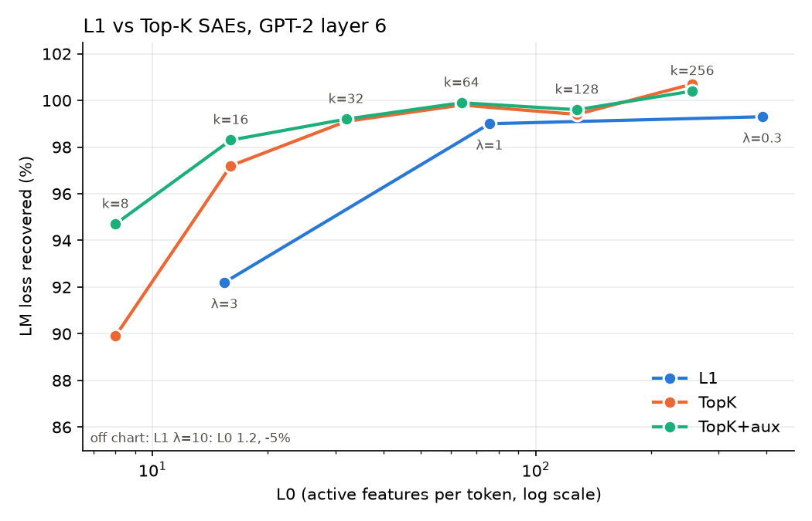

# Project 5 — Sparse Autoencoders (Dictionary Learning)

**Question:** *can we decompose activations into interpretable features?*

## Idea

Individual neurons are often **polysemantic** — they fire in many unrelated
contexts — plausibly because models represent more features than they have
dimensions, storing them in **superposition**
([Elhage et al., 2022](https://transformer-circuits.pub/2022/toy_model/index.html)).
A **sparse autoencoder (SAE)** tries to undo the compression: it learns an
overcomplete dictionary of directions such that each activation vector is a
sparse non-negative combination of them. Individual dictionary elements
("features") tend to be far more interpretable than neurons
([Cunningham et al., 2023](https://arxiv.org/abs/2309.08600);
[Bricken et al., 2023 — *Towards Monosemanticity*](https://transformer-circuits.pub/2023/monosemantic-features/index.html)),
and the approach scales to frontier models
([Templeton et al., 2024 — *Scaling Monosemanticity*](https://transformer-circuits.pub/2024/scaling-monosemanticity/index.html)).

## Architecture (the standard 2023 recipe)

```
f     = ReLU(W_enc (x − b_dec) + b_enc)     # sparse feature activations
x_hat = W_dec f + b_dec                     # reconstruction
loss  = ‖x − x_hat‖² + λ·Σf                 # fidelity + L1 sparsity
```

Decoder rows are renormalized to unit norm every step — otherwise the model
cheats the L1 penalty by shrinking `f` and growing `W_dec`.

### Top-K variant (Gao et al., 2025)

```
f     = TopK(ReLU(W_enc (x − b_dec) + b_enc))   # keep the k largest, zero the rest
loss  = ‖x − x_hat‖²                            # no L1 term
```

Sparsity is set directly (L0 = k) instead of being tuned through λ, and the
surviving activations are not shrunk by an L1 penalty. Small k leaves many
features that never win the top-k and stop getting gradient ("dead"); the
**AuxK** loss (`--aux-k`) asks dead features to reconstruct the main SAE's
residual error, which gives them a gradient again. This is the architecture
used by most recent SAE work, e.g. [SAE steering of medical VLMs](https://arxiv.org/abs/2605.24977)
(k=64, 8× dictionary).

## Run it

```bash
python train_sae.py                  # ~1-2 min on CPU
python train_sae.py --l1 3          # sparser, worse reconstruction
python train_sae.py --k 64 --aux-k 384   # Top-K SAE with dead-feature loss
python sweep.py                     # L1 vs Top-K trade-off curves, ~20 min
```

Downloads tiny-shakespeare (~1 MB), collects ~60k layer-6 residual-stream
vectors from GPT-2 small, trains a 768→3072 SAE, measures how much LM loss
survives splicing the reconstruction back into the model, then prints
top-activating contexts for a sample of features.

**Position 0 is excluded.** GPT-2's first token is an "attention sink" whose
residual norm is ~40× any other position's: kept in, those <1% of tokens carry
>90% of the squared norm and dominate the scale normalization and the MSE.

## What you should see

```
step     0  mse 2267.390  L0 (active feats)  1544.5
step  1999  mse   52.595  L0 (active feats)    75.7

L0 75.7   variance explained 86.7%
LM loss: clean 4.918  with SAE 4.945  mean-ablated 7.564  -> 99.0% of loss recovered
```

**Loss recovered** is the metric that matters: it asks whether the model can
still *use* the reconstruction. 0% = as bad as replacing layer 6 with its mean
activation, 100% = as good as the original.

Per-feature summaries — at this sparsity most sampled features have an
obvious theme:

```
feature 326 (fires on 0.4% of tokens):
    ... bear against the great Auf[[id]]
    ... hearing. Stand, Auf[[id]]

feature 2827 (fires on 3.4% of tokens):
    ... years upon thee; and thou[[ art]]
    ... to them,\nThou[[ art]]

feature 23 (fires on 5.8% of tokens):
    ...\nBRUTUS:\n[[Sir]]
    ...MENENIUS:\n[[Sir]]
```

Others are still mixed (e.g. a feature on `restrain`, `blind`, `ruin`,
`strong`). Feature quality depends heavily on data volume, dictionary size,
and the sparsity/fidelity trade-off.

## L1 vs Top-K sweep



| SAE | L0 | variance explained | dead | fire on >10% | loss recovered |
|---|---:|---:|---:|---:|---:|
| L1, λ=0.3 | 390 | 93.4% | 1.0% | 64.9% | 99.3% |
| L1, λ=1 | 76 | 86.7% | 2.4% | 2.6% | 99.0% |
| L1, λ=3 | 15 | 74.6% | 18.8% | 0.2% | 92.2% |
| L1, λ=10 | 1.2 | −13.2% | 99.6% | 0.0% | −4.8% |
| Top-K, k=8 | 8 | 75.3% | 75.7% | 0.2% | 89.9% |
| Top-K, k=16 | 16 | 82.9% | 55.1% | 0.4% | 97.2% |
| Top-K, k=32 | 32 | 88.0% | 23.7% | 1.0% | 99.1% |
| Top-K, k=64 | 64 | 90.8% | 6.1% | 2.5% | 99.8% |
| Top-K, k=128 | 128 | 92.7% | 0.8% | 7.3% | 99.4% |
| Top-K+AuxK, k=8 | 8 | 83.1% | 12.9% | 0.2% | 94.7% |
| Top-K+AuxK, k=16 | 16 | 86.7% | 8.8% | 0.4% | 98.3% |
| Top-K+AuxK, k=32 | 32 | 88.9% | 5.8% | 1.0% | 99.2% |
| **Top-K+AuxK, k=64** | **64** | **90.9%** | **1.7%** | **2.6%** | **99.9%** |
| Top-K+AuxK, k=128 | 128 | 92.7% | 0.3% | 7.2% | 99.6% |

(Full numbers incl. k=256 in `results/sweep.json`; its >100% loss recovered is
evaluation noise from the 20-chunk estimate.)

- **L1 at λ=0.2–0.3 is barely sparse**: L0≈390–570 of 768 dimensions and
  most features fire on >10% of tokens — a dense re-encoding with vague
  features. Near-perfect loss recovery means little without low L0.
- **Top-K beats L1 at every matched L0.** At L0≈16: 97–98% of loss recovered
  vs 92% for L1 (λ=3), and 83–87% vs 75% variance explained. L1 pays twice
  for sparsity: it switches features off *and* shrinks the ones it keeps.
- **Dead features are Top-K's failure mode**, and they get worse as k
  shrinks (76% dead at k=8, 55% at k=16). AuxK cuts that to 13% and 9%, and
  the revived features buy real fidelity at small k (90% → 95% at k=8).
- **L1 collapses at high λ** (λ=10: almost all features die and the
  reconstruction is worse than the mean activation). Top-K can't collapse
  that way, since exactly k features are always active.

Top-K+AuxK at k=64 gives the cleanest features we've seen at this scale:

```
feature 319 (fires on 0.6% of tokens):      feature 735 (fires on 0.9% of tokens):
    ...ET:\nO princely[[ Buckingham]]            ...I cannot\nPut on the[[ gown]]
    ...Here come the lords of[[ Buckingham]]     ...that so lamely and unf[[ashion]]
                                                ...yet my mind gave me his[[ clothes]]
feature 1623 (fires on 0.6% of tokens):
    ...\nBRUTUS:\n[[Go]]                          feature 1051 (fires on 1.9% of tokens):
    ...OUCESTER:\n[[Go]]                           ... them like a thing\nMade[[ by]]
                                                ... bitterness of soul\nDenounced[[ against]]
```

— a name, a line-initial command, a *semantic* clothing feature spanning
different tokens, and a grammatical "past participle → preposition" feature.

## Honest caveats

- This toy run uses ~60k tokens; real SAEs train on **billions**. Expect
  suggestive, not clean, features.
- Loss recovered is measured on 20 chunks that are also in the training set,
  so it is optimistic.
- Known open problems: dead features, feature splitting, and whether SAE
  features are the model's "real" units at all. See
  [SAELens](https://github.com/jbloomAus/SAELens) and
  [Neuronpedia](https://www.neuronpedia.org/) for tooling and browsable
  pre-trained SAEs, and [Gemma Scope](https://arxiv.org/abs/2408.05147) for a
  full open-source SAE suite.

## Extensions

- Rerun `sweep.py` with more `--steps` and a larger `--max-tokens`: does
  more data push the frontier up? Track dead features as you go.
- Train on MLP activations instead of the residual stream.
- Pick one interpretable feature and *steer*: add its decoder direction to the
  residual stream during generation and watch the output change.
